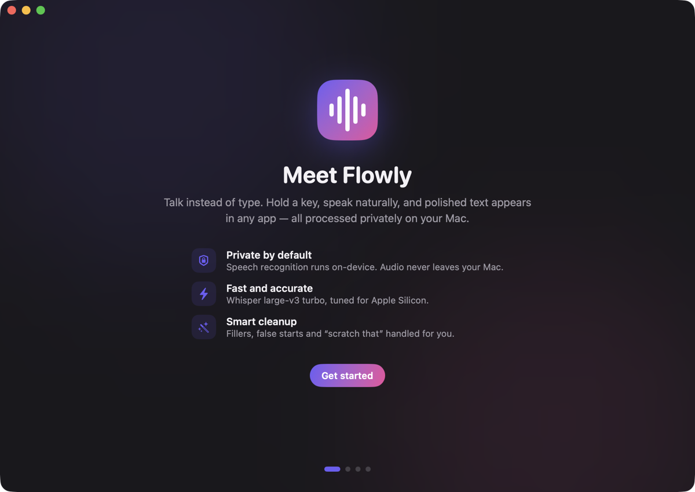

<div align="center">



# Flowly

**Private, on-device voice dictation for macOS.**
Hold a key, speak naturally, and polished text appears in whatever app you're typing in.

[](https://github.com/Harshithvarma007/Flowly/actions/workflows/ci.yml)
[](LICENSE)


</div>

Flowly is a menu-bar dictation app in the spirit of Wispr Flow. Speech recognition runs locally with Whisper (via [WhisperKit](https://github.com/argmaxinc/WhisperKit)), so your audio never leaves your Mac. An optional local LLM then cleans the transcript up: fillers removed, self-corrections applied, lists and paragraphs built, tone matched to the app you're in.

- Native Swift / SwiftUI, about 2,300 lines, no Electron
- Requires macOS 14+ and Apple Silicon (M1 or later)
- Build tools: Xcode 15+ (developed with Swift 6.4)

## Install

**Download:** grab `Flowly.zip` from the [latest release](https://github.com/Harshithvarma007/Flowly/releases/latest), unzip, and drag `Flowly.app` to `/Applications`.

**Or build from source** (see [Build from source](#build-from-source)):

```bash
git clone https://github.com/Harshithvarma007/Flowly.git
cd Flowly
./scripts/build_app.sh
open dist/Flowly.app
```

First launch:

1. macOS may block an ad-hoc signed app. Right-click the app > **Open** > **Open**
   (or run `xattr -dr com.apple.quarantine /Applications/Flowly.app`).
2. Follow the onboarding: grant **Microphone**, **Accessibility** and **Input Monitoring**, pick a shortcut, wait for the one-time model download (~630 MB).
3. Click into any text field, **hold Fn**, speak, release.

Flowly is a menu-bar app: there is no Dock icon. Look for the waveform icon at the top-right of the menu bar (click it for "Home & Settings..."). The window also opens every time you launch the app.

If Fn opens the emoji picker: System Settings > Keyboard > "Press globe key to" > **Do Nothing**.

## Features

| Feature | Details |
|---|---|
| Push-to-talk dictation | Hold to talk; quick tap latches hands-free, tap again to finish; **Esc** cancels |
| Works in any app | Pastes via Cmd+V and restores your clipboard afterward |
| On-device Whisper | Large-v3 Turbo (default on 16 GB+), Small (8 GB Macs), Base, Large-v3 full; chosen automatically by RAM |
| Multilingual | Auto-detect or pick from 20 languages |
| Auto cleanup | Removes um/uh and stutters, "scratch that" backtracking, "new line"/"new paragraph", auto-capitalize |
| Dictionary | Custom words bias recognition; optional "heard as" to written replacements |
| Snippets | Say a trigger phrase, get the full text |
| AI cleanup (on by default) | A local LLM rewrites the transcript: removes fillers, applies self-corrections ("no wait, ask Priya"), fixes grammar, builds lists and paragraphs, writes numbers/emails/code identifiers properly; tone matched to the frontmost app (Mail, Slack, Xcode...) and a Natural / Professional / Casual / Concise style |
| Command Mode (optional) | Select text, hold the command key, say "make this friendlier"; with no selection, generates text from your instruction |
| Live preview | Your words appear in the overlay while you speak (rolling Whisper pass over recent audio) |
| Cursor & screen context | Reads the text around your cursor via Accessibility (never password fields; local engines only) so output continues mid-sentence correctly, adds a missing space, and spells names visible on screen |
| Auto-learning dictionary | After inserting, watches the field; when you fix a word (e.g. harshit -> Harshith) it's added to the dictionary as "Learned" |
| History and stats | Searchable, grouped by day; words today / total / words per minute |
| Extras | Microphone picker, sound cues, press-Return-after-insert, launch at login, light and dark mode, floating waveform overlay |

### AI engines

Engine order in **Automatic** mode: **Ollama** (local, preferred) > Apple Intelligence (macOS 26+, on-device) > Claude API (optional, key in Keychain; only text is sent, never audio). If none is available, Flowly falls back to rule-based cleanup.

Ollama setup: install [Ollama](https://ollama.com), then `ollama pull qwen3.5:4b`. In our tests on messy dictations qwen3.5:4b gave the best cleanup (correct self-corrections, clean lists, no invented content), ahead of llama3.1:8b and qwen3:8b. Pick any installed model in *AI & Style*. The model is kept warm in memory; cleanup adds about 1 second.

Safeguards: the transcript is treated as content, never as instructions (a dictated question is not answered); output that looks like commentary, a refusal, or a hallucination is rejected and the rule-cleaned text is used instead.

## Default shortcuts

| Action | Key |
|---|---|
| Dictate | Fn (hold, or tap to latch) |
| Command Mode | Right Option |
| Cancel | Esc |

Both are changeable in Settings (Fn, Right Option, Right Command, Right Control).

## Build from source

```bash
./scripts/build_app.sh        # builds dist/Flowly.app (release, signed)
```

The script runs `swift build -c release`, generates the icon, writes `Info.plist` (microphone usage string, `LSUIElement`), and signs the bundle with the microphone entitlement.

**Keeping permissions across rebuilds.** Ad-hoc signed builds look like a new app to macOS, so Accessibility / Input Monitoring reset after every rebuild.
The build script avoids this by signing with a self-signed certificate named **Flowly Dev** if one exists in your login Keychain. Create it once:

```bash
cat > cert.cnf <<'CNF'
[req]
distinguished_name = dn
x509_extensions = ext
prompt = no
[dn]
CN = Flowly Dev
[ext]
basicConstraints = critical,CA:false
keyUsage = critical,digitalSignature
extendedKeyUsage = critical,codeSigning
CNF
openssl req -x509 -newkey rsa:2048 -nodes -keyout key.pem -out cert.pem -days 3650 -config cert.cnf
openssl pkcs12 -export -inkey key.pem -in cert.pem -out flowly.p12 -passout pass:flowly -name "Flowly Dev"
security import flowly.p12 -k ~/Library/Keychains/login.keychain-db -P flowly -T /usr/bin/codesign
rm key.pem flowly.p12 cert.cnf
```

macOS will list it as "not trusted", which is fine for local use. If Keychain asks whether `codesign` may use the key, choose **Always Allow**.
After this, grant the permissions once; later rebuilds keep them.

### Self-test (no microphone needed)

```bash
say -o /tmp/t.aiff "Um, let's meet at three. Scratch that, let's meet at four."
ffmpeg -y -i /tmp/t.aiff -ar 16000 -ac 1 /tmp/t.wav
dist/Flowly.app/Contents/MacOS/Flowly --selftest /tmp/t.wav          # speech -> text -> AI cleanup
dist/Flowly.app/Contents/MacOS/Flowly --polish "um so first the budget second the hiring plan" ollama qwen3.5:4b
```

Downloads the model if needed, transcribes the file, and prints the raw and cleaned text.
Debug env vars for UI screenshots: `FLOWLY_PAGE=<Home|Settings|Model|...>`, `FLOWLY_STEP=<0-3>`, `FLOWLY_LIGHT=1`, `FLOWLY_HUD=1`.

## Prompt quality: eval harness

`tests/polish_cases.json` holds 45 real-world dictation cases (self-corrections, lists, question bullets, numbers/emails/code, multilingual, injection, context continuation, tone). Each has pass/fail checks.

```bash
dist/Flowly.app/Contents/MacOS/Flowly --eval tests/polish_cases.json ollama qwen3.5:4b
```

Prints PASS/FAIL per case and an overall score. Current results: qwen3.5:4b 45/45 (about 0.5 s per case); Apple Intelligence 37/45. Because the prompt was tuned on this set, treat it as a regression guard: when you find a dictation that comes out wrong, add it to the JSON, adjust the prompt in `LLM.swift`, and re-run to make sure nothing else regresses. Numbers that must never be altered (spoken digit runs) are converted by rule in `TextProcessor.convertDigitRuns` before the model sees them.

## Project layout

```
Package.swift              SwiftPM manifest (WhisperKit dependency)
scripts/build_app.sh       Build, icon, Info.plist, codesign
scripts/make_icon.swift    Draws the app icon
scripts/Flowly.entitlements
Sources/Flowly/
  main.swift               App entry, menu-bar item, window, --selftest
  Controller.swift         Orchestrates record -> transcribe -> clean -> (AI) -> insert
  Hotkey.swift             Global push-to-talk via CGEventTap (hold / latch / Esc)
  Audio.swift              AVAudioEngine capture to 16 kHz mono; mic device listing
  Transcriber.swift        WhisperKit model download/load and transcription
  TextProcessor.swift      Rule-based cleanup, backtracking, dictionary, snippets
  LLM.swift                AI cleanup + Command Mode; Ollama / Apple Intelligence / Claude engines, prompt, output validation
  Inserter.swift           Clipboard-safe paste, selection capture, frontmost app
  HUD.swift                Floating recording / processing overlay
  Context.swift            Reads text around the cursor / window title via Accessibility
  Learner.swift            Learns word corrections you make after insertion
  Eval.swift               --eval test-set runner
  Store.swift              Dictionary, snippets, history (JSON), stats
  Prefs.swift              Settings keys, model catalog, Keychain wrapper
  Theme.swift              Design system (colors, cards, keycaps, buttons)
  Views.swift              Sidebar window and all pages
  Onboarding.swift         First-run flow
```

Data lives in `~/Library/Application Support/Flowly/` (`store.json`, `Models/`). Delete that folder to reset.

## How it works

1. `HotkeyManager` watches modifier-key events through a CGEventTap (needs Accessibility).
2. `AudioRecorder` captures the mic and resamples to 16 kHz mono floats.
3. On release, `Transcriber` runs Whisper with VAD chunking and dictionary words as a prompt bias.
4. `TextProcessor` cleans the text; hallucinated silence output ("Thank you.") is filtered.
5. `LLM` restructures the text (or runs Command Mode) with the local model; invalid output falls back to step 4's text.
6. `Inserter` pastes into the focused app and restores the clipboard.

Measured on an M2 Pro (36 GB): about 1.3 s to transcribe 8 s of speech with Large-v3 Turbo.

## Known limitations

- Live preview is approximate (a fast partial pass); the final text appears after you release the key (about 1-2 s including AI cleanup).
- Screen context uses the focused text field and window title, not OCR of the whole screen. Some apps (e.g. some Electron apps) expose no field text.
- No cross-device sync; macOS only.
- Ad-hoc signed, not notarized; see the install note above.

## Contributing

Issues and pull requests are welcome; see [CONTRIBUTING.md](CONTRIBUTING.md).

## License

[MIT](LICENSE) (c) 2026 N Sai Harshith Varma.

## Research and credits

Feature set modeled on Wispr Flow's public docs. Open-source projects surveyed for design ideas
(no code copied): OpenWhispr, VoiceInk (GPL), FluidVoice, Hex, Psst Free, FreeFlow.
Speech engine: [WhisperKit](https://github.com/argmaxinc/WhisperKit) (MIT) running OpenAI Whisper models.

## Troubleshooting

- **Dictation transcribes but nothing is pasted / nothing in history:** read `~/Library/Application Support/Flowly/debug.log`. Each dictation logs its stages (`transcribed` -> `engine=...` -> `inserting` -> `inserted`) and any drop reason (`dropped: ...`, `polish failed ...`, `transcription hung ...`). The AI step has a hard time limit (28 s cold, 9 s warm) after which the basic-cleaned text is pasted instead, and the text is saved to history before pasting, so it is never lost.

- **Hold key does nothing:** switch Flowly on under Privacy & Security > Accessibility **and** Input Monitoring. If it is already listed from an older build, remove it with "-" and add it again (ad-hoc signed rebuilds look like a new app to macOS). Diagnostics are written to `~/Library/Application Support/Flowly/debug.log`.
- **No window / no icon:** it is a menu-bar app; click the waveform icon > Home & Settings, or launch it again.
